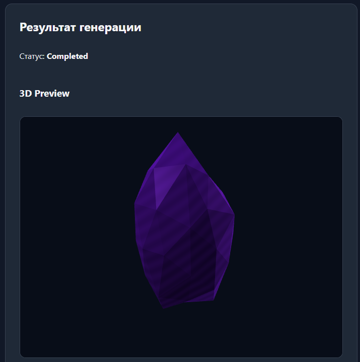

# ShaderGenerator

Микросервисное приложение для генерации GLSL-шейдеров с помощью локальной AI-модели.

Пользователь описывает желаемый внешний вид 3D-объекта, после чего нейросеть генерирует Vertex и Fragment Shader. Результат сохраняется в базе данных и отображается в браузере с использованием Three.js.

## Демонстрация



## Технологический стек

- **Backend:** C#, .NET 8, ASP.NET Core
- **Frontend:** React, TypeScript, Vite
- **3D-графика:** Three.js, React Three Fiber
- **База данных:** PostgreSQL, Entity Framework Core
- **Брокер сообщений:** RabbitMQ
- **AI:** LM Studio, Qwen 3

## Архитектура проекта

Приложение состоит из нескольких независимых компонентов:

- **UserService** — создание пользователей и работа с пользовательскими данными.
- **ShaderService API** — принимает запросы на генерацию, создаёт записи в БД и отправляет сообщения в RabbitMQ.
- **ShaderService Worker** — обрабатывает сообщения, взаимодействует с AI-моделью и сохраняет результат генерации.
- **Contracts** — содержит общие контракты сообщений для взаимодействия сервисов.
- **React Client** — пользовательский интерфейс для отправки запросов и отображения 3D-объектов.

## Запуск проекта локально

### Требования

- .NET 8 SDK
- Node.js и npm
- Docker Desktop
- PostgreSQL
- LM Studio с загруженной моделью Qwen 3 или другой подходящей по параметрам

### 1. Запуск RabbitMQ

Из корневой директории проекта:

```bash
docker compose up -d
```

### 2. Настройка LM Studio

- Запустить локальный сервер LM Studio.
- Настроить `appsettings.json` проекта `ShaderService.Worker` указав url сервера и название модели 

### 3. Настройка backend

Указать строки подключения PostgreSQL в конфигурационных файлах соответствующих сервисов.

При необходимости применить миграции Entity Framework Core.

### 4. Запуск backend-сервисов

Каждый сервис запускается в отдельном терминале из корневой директории решения:

```bash
dotnet run --project "UserService/UserService.Api/UserService.Api.csproj"
```

```bash
dotnet run --project "ShaderService/ShaderService.Api/ShaderService.Api.csproj"
```

```bash
dotnet run --project "ShaderService/ShaderService.Worker/ShaderService.Worker.csproj"
```

### 5. Запуск frontend

```bash
cd Client
npm install
npm run dev
```

Открыть приложение:

```text
http://localhost:5173
```
